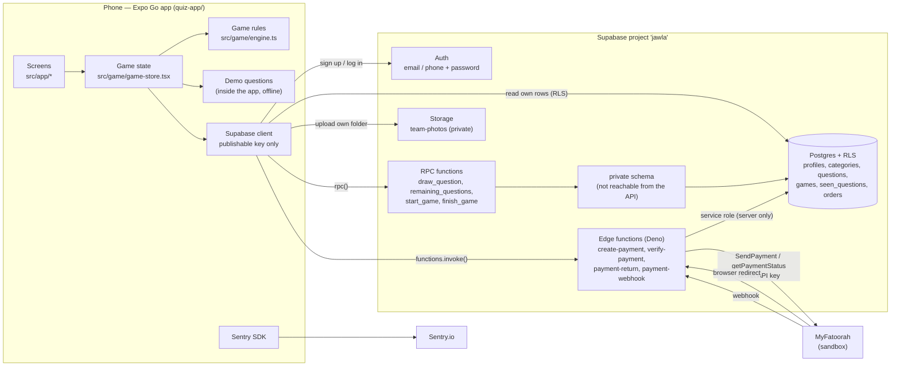
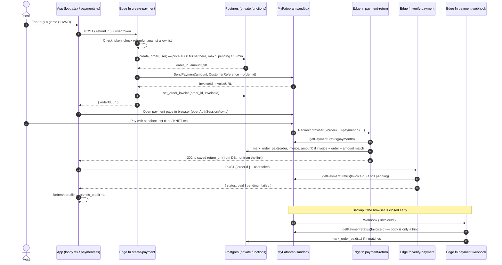
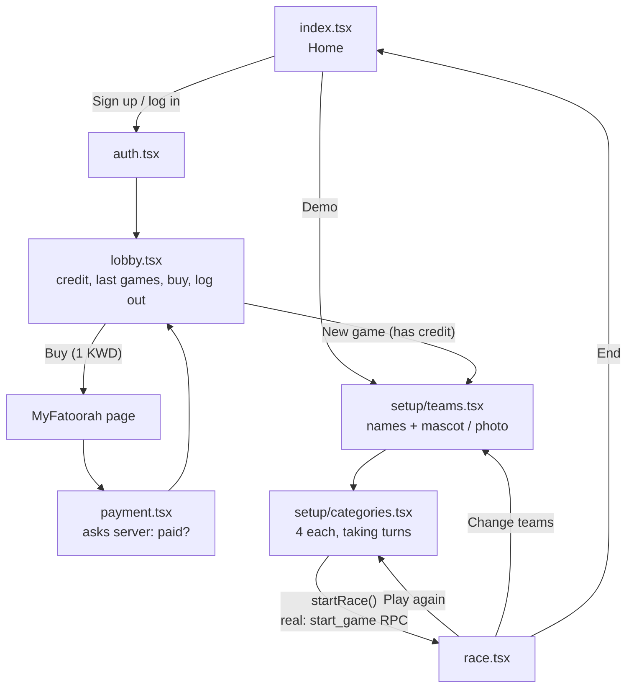
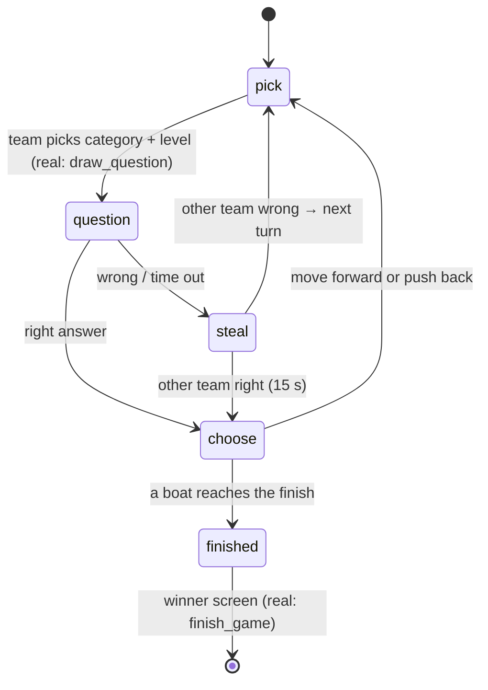

# Jawla — Architecture

This page explains how the app, Supabase and MyFatoorah work together, and where each security rule lives.

## 1. The big picture

Key points:

- The app holds **only the publishable key**. It can read its own rows (RLS) and call a few RPC functions.
- Public RPC functions are thin wrappers. The real work runs in the **`private` schema**, which the API does not expose.
- Edge functions use the **service role** and the **MyFatoorah API key**. Both live only in Supabase secrets.
- The demo needs no server at all: its questions and rules are in the app.

## 2. Payment flow

Why it is safe:

- The app **never sends an amount**. The price comes from `private.game_price_fils()` (1000 fils).
- The status in the return link is ignored. The server always asks MyFatoorah itself (`settleOrder` in `supabase/functions/_shared/myfatoorah.ts`).
- `mark_order_paid` changes the order from `pending` to `paid` **once**, only when invoice id, order id and amount all match. Then it adds 1 credit. A second call does nothing.
- The return link must match an allow-list (`jawla://payment`, Expo Go on a private network or `exp.direct`, localhost) — no open redirect.

## 3. "Never trust the device" — where each rule is enforced

| Rule | Enforced in | How |
|---|---|---|
| Price of a game | `private.game_price_fils()`, `private.create_order` (migration `m6_orders`) | App sends no amount; order amount is written by the server |
| Payment is real | `settleOrder` in `functions/_shared/myfatoorah.ts` | Server calls MyFatoorah `getPaymentStatus`; checks invoice, `CustomerReference` and amount |
| Credit added once | `private.mark_order_paid` | Atomic `pending → paid` update; credit only if that update happened |
| Credit can't be edited | `profiles` grants (migration `m3_schema`) | User may update only `display_name`; `games_credit >= 0` check |
| Game unlocks only with credit | `private.start_game` (migration `m5_games`) | Takes 1 credit atomically (`games_credit > 0`), else `no credit` |
| Game input is valid | `private.start_game` | 2 team names (1–20 chars, different), mascot ids, 8 different active categories, photo paths in own folder |
| Which question you get | `private.draw_question` | Random unseen question, picked on the server, one at a time |
| No repeated questions | `seen_questions` primary key `(user_id, question_id)` | A question can be recorded once per account |
| Category belongs to the game | `private.draw_question` | `category not in this game` error |
| One credit ≠ endless game | `private.draw_question` (migration `m8_hardening`) | Game stops after 6 hours or 100 questions |
| Questions can't be bulk-read | RLS on `questions`, no policies, no grants | Only `draw_question` reads it |
| Payment spam | `private.create_order` | Max 5 pending orders per 10 minutes, per-user lock |
| Photos private | Storage policies on `team-photos` | Own folder only (`<user id>/…`), 2 MB, jpg/png/webp |
| Secrets | Supabase secrets, git-ignored `.env` | App has only `EXPO_PUBLIC_*` values |

Accepted on purpose: the device reports the **winner** (`finish_game`). It only changes the player's own history; there is no leaderboard.

## 4. Tables and RLS

| Table | What it stores | RLS / access for the app |
|---|---|---|
| `profiles` | one row per user: display name, `games_credit` | Read own row; update only `display_name`. Row made by a trigger on sign-up |
| `categories` | id, Arabic name, emoji, colour, order, active | Anyone (even not signed in) reads active ones |
| `questions` | question, answer, points (2/3/4/5), category, `is_sample` | RLS on, **no policies** — no direct read. Only via `draw_question` |
| `games` | owner, status (active/finished/abandoned), team names, mascots, photos, 8 categories, lane length, winner | Read own games. Written only by `start_game` / `finish_game` |
| `seen_questions` | (user, question, game) | Read own rows. Written only by `draw_question` |
| `orders` | owner, `amount_fils`, status (pending/paid/failed), invoice id | Read own orders (some columns only). Written only by edge functions (service role) |
| Storage `team-photos` | team photos | Private bucket; upload / read / delete own folder only |

Server functions the app may call (signed-in users only):

| Function | Does |
|---|---|
| `draw_question(game, category, points)` | Gives one unseen question and records it |
| `remaining_questions(categories)` | How many unseen questions are left per category + level |
| `start_game(names, mascots, categories, photos)` | Checks input, takes 1 credit, creates the game |
| `finish_game(game, winner)` | Marks the game finished (winner) or abandoned (null) |

Functions only the edge functions may call (service role): `create_order`, `set_order_invoice`, `mark_order_paid`, `mark_order_failed`.

## 5. Game state in the app

The rules are pure functions in `src/game/engine.ts` (tested in `engine.test.ts`).
`src/game/game-store.tsx` keeps the state and talks to the server in real mode.

### Screens

### Turn phases (engine)

Notes:

- **Demo mode**: lane 10 steps, questions from `demo-questions.ts`, no server calls.
- **Real mode**: lane 20 steps; `start_game` makes the game, `draw_question` gives each question, `remaining_questions` greys out finished categories, `finish_game` saves the winner (or "abandoned" when the host ends early).
- **Comeback**: when the rival is 4 steps or less from the finish, the team's 5-point question becomes `available`; after use it is `used`.
- Boats never go behind the start line.

## 6. Monitoring

`src/lib/monitoring.ts` wraps the app with Sentry. It reports crashes and failed server calls (start game, draw question, buy game, verify payment). It is off until `EXPO_PUBLIC_SENTRY_DSN` is set. No email, phone, IP or screenshots are sent — only an anonymous account id.
